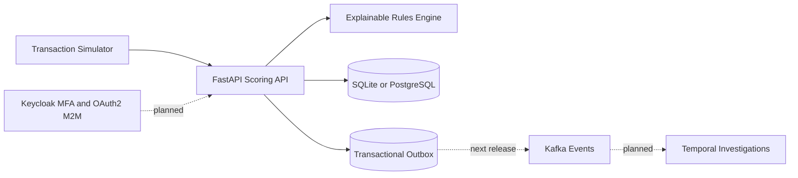

# FraudShield Python 🛡️

**Explainable fraud-risk decisions with an idempotent REST API and transactional event outbox.**

> **v0.1 MVP — synthetic data only.** This is not a production payment processor. Temporal, Kafka, MFA, OAuth2 M2M and machine learning are planned, not yet implemented.

## Features
- FastAPI and Pydantic models with generated OpenAPI documentation.
- Explainable risk rules for amount, geography, device novelty and transaction velocity.
- Decisions: `allow` (score < 50), `review` (50–89), `decline` (90–100).
- Idempotency by transaction UUID: identical retries return the original result; conflicts return HTTP 409.
- Persist transaction decisions and `transaction.scored.v1` event records atomically.
- SQLite local mode and PostgreSQL with Docker Compose; unit/API tests and GitHub Actions.

**Security:** Currently unauthenticated. Do not expose to public networks or use real banking data. Feature signals in this MVP are caller-provided, not independently verified. Kafka event dispatch is not yet implemented.

## Quick start

Requires Python 3.11 or newer.

```bash
python -m venv .venv
source .venv/bin/activate
pip install -e '.[dev]'
uvicorn fraudshield.api:app --reload
```

Open [interactive API docs](http://localhost:8000/docs).

Run against PostgreSQL instead:

```bash
docker compose up --build
```

Submit a sample suspicious transaction:

```bash
curl -X POST http://localhost:8000/api/v1/transactions \
  -H 'Content-Type: application/json' \
  --data @examples/high_risk.json
```

The included synthetic example yields `score: 100` and `decision: decline`.

## Endpoints

| Method | Route | Purpose |
| --- | --- | --- |
| GET | `/health` | Liveness (not database readiness) |
| POST | `/api/v1/transactions` | Score and store a transaction |
| GET | `/api/v1/transactions/{transaction_id}/risk` | Retrieve a stored decision |

## Architecture



Read [Architecture Decisions](docs/ARCHITECTURE.md), [Security](docs/SECURITY.md), and [Roadmap](docs/ROADMAP.md).

## Quality checks

```bash
ruff check .
pytest -q
```

Contributions should include tests and updated docs for behavior changes. MIT licensed; see [LICENSE](LICENSE).
